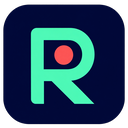

# Record By Me

Record By Me is an independent fork of [Recordly](https://github.com/webadderallorg/Recordly), created by webadderall and developed with the Recordly contributors. This fork adds Windows audio synchronization fixes, voice-over recording, and independent audio track editing.

Record By Me uses the same GNU Affero General Public License v3. Recordly began as a fork of OpenScreen by Siddharth Vaddem. The original copyright and MIT notice for the OpenScreen code are included in [LICENSE.md](LICENSE.md).

## Windows download

Download the Windows x64 setup program from [GitHub Releases](https://github.com/cplymill/recordbyme/releases). The installer includes the recorder and editor. Git and Node.js are only needed for development.

## Development

I use OpenAI Codex and other AI tools to help develop, debug, and test Record By Me.

Install dependencies with `npm ci`, run the editor with `npm run dev`, and build the Windows installer with `npm run build:win`.

## Sync with GitHub

After committing your changes, double-click **Sync Record By Me.cmd** on Windows or run `npm run sync`. This pulls compatible changes from your tracked branch on `origin` and pushes your local commits. If both sides have new commits, sync stops so you can review and merge them.

[Original Recordly documentation and contributor acknowledgements](https://github.com/webadderallorg/Recordly/tree/v1.4.0)
